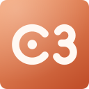

<p align="center">
  
</p>

<h1 align="center">C3 Code</h1>

<p align="center">One fast interface for the coding agents on your machine. No usage data, ever.</p>

<p align="center">
  <a href="./docs/README.md">Docs</a> ·
  <a href="./docs/user/privacy.md">Privacy and network calls</a> ·
  <a href="https://github.com/CoreCodeAI/c3code/releases">Releases</a>
</p>

> [!IMPORTANT]
> C3 Code is an **unofficial fork** of [T3 Code](https://github.com/pingdotgg/t3code). It is not
> affiliated with, endorsed by, or supported by T3 Tools, Inc. "T3 Code" is a trademark of T3 Tools,
> Inc. Report C3 Code problems here, not to the T3 Code project.

C3 Code runs the coding agents on your machine and gives them one interface: Claude Code, Codex,
Cursor, OpenCode, Grok Build, Antigravity, Kiro, Pi, Muse Code, fx, and any
[ACP](./docs/user/providers-acp.md) agent. Start a thread at your desk, then pick it up from another
machine or your phone.

## What is different from T3 Code

- **No data collection.** The product analytics (PostHog), relay tracing (Axiom), install and device
  IDs, agent feedback delivery, and mobile crash and trace reporting are removed from the code, not
  switched off. C3 Code also asks every agent CLI it starts not to send telemetry.
- **Nothing hosted by default.** T3 Connect is off: builds carry no relay, sign-in, or Expo project
  of T3's. You can point a source build at a relay and Clerk instance you run (see
  [`.env.example`](./.env.example)).
- **Its own name and look.** The C3 mark, icons, and name replace T3 Code's branding, as T3's
  [trademark policy](./TRADEMARK.md) asks of forks.
- **Links that stay here.** Install scripts, update checks, the model list, issue links, and
  `t3 triage` point at this repository, never at T3's site, npm package, or app store listings.
- **Installs beside T3 Code.** C3 Code keeps its data in `~/.c3`, listens on port 3873, and has its
  own app id (`live.corecode.c3code`) and service names, so both can run on one machine.
  [Beside T3 Code](./docs/user/install.md#beside-t3-code) covers moving your T3 Code data over.

[Privacy and network calls](./docs/user/privacy.md) lists every connection C3 Code still makes,
and why.

## Install

C3 Code has no signed release builds yet. Build it from source with the
[development runbook](./docs/operations/00_development.md#first-checkout):

```bash
curl -fsSL https://vite.plus | bash   # installs Vite+ (`vp`), which pins Node
git clone https://github.com/CoreCodeAI/c3code.git
cd c3code
vp i
vp run dev
```

Open the pairing URL the dev runner prints. `vp run dev:desktop` starts the desktop app.

Once releases are published on this repository, the install scripts here install the `t3` command:

```bash
curl -fsSL https://raw.githubusercontent.com/CoreCodeAI/c3code/main/scripts/install.sh | sh
```

On Windows, in PowerShell:

```powershell
irm https://raw.githubusercontent.com/CoreCodeAI/c3code/main/scripts/install.ps1 | iex
```

Do not use `npx t3` or the T3 Code installers: they install T3 Code, not this fork.

### Sign in to an agent

C3 Code needs one agent that is installed and signed in. For example, install
[Claude Code](https://claude.com/product/claude-code) and run `claude auth login`, or install
[Codex CLI](https://developers.openai.com/codex/cli) and run `codex login`.
[Provider setup](./docs/user/install.md#providers) has the steps for each agent.

## What you get

- **Your subscriptions.** C3 Code does not resell tokens. It drives the agents you are already
  signed in to.
- **Every agent in one place.** Change models in the middle of a thread. Let Claude hand a task to
  Codex.
- **Desktop, web, and phone.** One server, and every client shows the same threads.
- **Remote ready.** Run agents on any machine. Connect over your local network, Tailscale, or a
  relay you run.
- **Git built in.** Each thread can work in its own worktree. Review the diff, then commit, push,
  and open a pull request with one button.

## Documentation

- [Install and first run](./docs/user/install.md)
- [Privacy and network calls](./docs/user/privacy.md)
- [Remote access from a phone or another machine](./docs/user/remote-access.md)
- [Permission modes](./docs/user/permission-modes.md)
- [Source control](./docs/user/source-control.md)
- [FAQ](./docs/user/faq.md)

[All docs](./docs/README.md) has the full list.

## Contributing

Read [CONTRIBUTING.md](./CONTRIBUTING.md) before you open an issue or a pull request. Build from
source with the [development runbook](./docs/operations/00_development.md#first-checkout); the
[architecture overview](./docs/internals/01_architecture.md) explains how it works.

## License and trademarks

The source code is licensed under the [MIT License](./LICENSE), as T3 Code's is. The license covers
source code only. T3 Code's name, wordmark, logos, and icons belong to T3 Tools, Inc. and are not
used here; see [TRADEMARK.md](./TRADEMARK.md).
